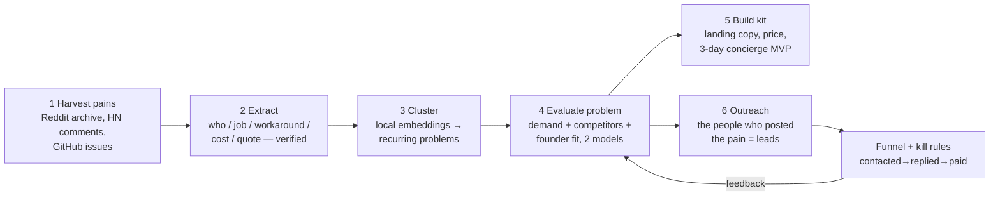

# IdeaPulse v2 — from "idea feed" to "first dollar machine"

*Written 2026-11-02 after auditing the running app, its database, the cron log, and the two research reports.*

---

## 1. What is actually wrong today (measured, not guessed)

| Finding | Evidence | Effect |
|---|---|---|
| **The evaluator is mostly failing, and failures are stored as `SKIP`** | `nvidia/nemotron-3-super-120b-a12b:free` (first in `EVAL_MODELS`) was removed from OpenRouter → 475 × "HTTP 404". Another ~300 failures are "no json / empty / 429". Daily log: `models: {"none": 23, "ultra": 2}` | ~780 of the 1,043 "SKIP" verdicts are errors, not judgments. Good ideas were silently buried. |
| **Most items were never evaluated** | 2,676 of 3,742 items have `verdict IS NULL`; the cron evaluates 25/day while fetching ~60/day | The backlog grows forever. |
| **Reddit — the best pain source — has been dead since Oct 13** | `reddit.com/*.json` and `search.rss` both return **403** from this Mac; log shows `Reddit: +0` every day | You lost the only source where buyers describe problems. Product Hunt and Lobsters also return 0. |
| **The sources are launch feeds, not pain feeds** | Show HN, GitHub Trending, dev.to, Google Trends = things *already built* or news | The evaluator is asked "should I build this?" about other people's products. That's why almost everything is SKIP and the two BUILDs are weak. |
| **The evaluator sees only a title** | `_eval_call(title, meta)` — no post body, no comments, no competitor check | Judgments are guesses. Nothing counts how *often* a pain recurs. |
| **No demand clustering** | Each post is judged alone | The research's strongest idea — "this pain shows up 60 times a month" — can't be detected. |
| **Outreach has not happened** | `prospects`: 17 `new`, 1 `contacted` (Siri Dental, Sep 1). Demo link hardcoded in every pitch (`cents-smithsonian-…trycloudflare.com`) is **dead** | This is the real reason for $0. The plan in `../DECISION.md` asked for 20 DMs/day; 1 was sent in two months. |

**Honest bottom line:** the missing dollar is not caused by a missing idea. It's caused by zero customer conversations. A better idea engine helps only if it hands you a list of *specific people who already have the pain* and makes contacting them the default daily action. The redesign below is built around that.

## 2. What the attached research is worth

The two reports were AI-assembled; the citations are stripped and several quotes can't be traced. So treat them as **hypotheses to verify**, not evidence. Useful parts:

- The **source list** is right in spirit: buyers describe pain in r/smallbusiness, r/Entrepreneur, r/freelance, r/ecommerce, r/SaaS, r/sysadmin, r/Bookkeeping, r/FulfillmentByAmazon, Ask HN, and GitHub issues. These feeds should replace the launch feeds.
- The **pain phrase patterns** are right: "is there a tool", "I wish there was", "I'd pay for", "spend hours", "manually", "hate doing", "alternative to", "so frustrating".
- The **scoring rubric** (time-to-launch, demand, founder fit, effort) is reasonable.

What the reports get wrong:

- The **top-ranked ideas are crowded**. Receipt matching has Dext, Hubdoc, QuickBooks, and Expensify. Invoice chasing has Chaser and every invoicing tool, plus Khatabook/Vyapar in India. Chargebacks have Chargeflow and Chargebacks911. Webhook replay has Hookdeck and Svix. Lead dedupe has Dedupely and Insycle. The rubric never checked competitors. That's the step IdeaPulse must automate.
- "Time-to-first-dollar 2–3 weeks" assumes customers exist. Nothing in the reports finds a single named buyer.

A quick live count (Arctic Shift Reddit archive, May–Nov 2026, partial because of rate limits) confirms some pains really recur: **chargeback ≈ 63 posts** in 3 subs, **receipts ≈ 42** in r/Bookkeeping alone, **late invoice ≈ 16** in r/freelance alone. These recur, but each is still crowded, so any build needs a narrow wedge.

## 3. The new pipeline (6 stages)

### Stage 1 — Harvest pains, not launches

- **Reddit through the Arctic Shift API** (`arctic-shift.photon-reddit.com`, confirmed 200 today): posts and top comments from ~15 pain subreddits, filtered by the pain phrases above. It rate-limits (429 after ~8 calls) and rejects full-text search on huge subs (422), so it runs as a **paced nightly batch**: ~1 request per 3 s, newest-first listing plus local phrase filter, cached by post id.
- **HN Algolia comment search** for pain phrases (`tags=comment`, keyless, generous limits).
- **GitHub issues search API** for `label:enhancement` + "would pay" / "workaround" in popular SMB-tool repos.
- Keep Show HN / GitHub Trending as a separate **"Trends" lane** (useful context, never treated as ideas).
- Store the **full body + top 5 comments + author + permalink**, not just a title.

### Stage 2 — Extract structured pain (free models)

One free-model call per post returns JSON: `persona`, `job_to_be_done`, `current_workaround`, `tools_mentioned`, `cost_signal` (hours or money), `pay_signal` ("I'd pay", "we pay $X for…"), `verbatim_quote`.

- **Anti-hallucination rule** (same idea as iReader fact-check): the quote must be a substring of the source text, or it is dropped.
- Posts with no real pain are discarded here, so the evaluator only ever sees real problems.

### Stage 3 — Cluster into recurring problems

- Embed each pain with local `nomic-embed-text` (Ollama, already installed) and group with simple cosine clustering.
- **Problem score** = distinct authors × recency × pay signals × money/time cost. This is the "validated demand" number the research talked about but never computed.

### Stage 4 — Evaluate the problem, not the post

- Inputs: cluster summary, 5 best quotes, mention count, and a **competitor scan** (keyless `ddgs` web search for "<problem> software", "<incumbent> alternative", top 5 results + pricing pages).
- Rubric: demand (from stage 3), competition gap / wedge, founder fit (Java/Spring staff engineer, WhatsApp + AI bots already built, India and global), days to a sellable concierge version, price point.
- **Checker + critic on two different free models.** The verdict comes with a named wedge ("Chargeflow takes 25% of recovered money; a $19 one-off evidence-letter kit for Shopify sellers under $50k/yr").
- **A failure becomes `ERROR` and is retried. It never becomes `SKIP`.**

### Stage 5 — Build kit (one click on a BUILD problem)

The kit generates:

- landing-page copy written from the verbatim quotes;
- price and payment-link checklist: Gumroad/Lemon Squeezy for global buyers, Razorpay/UPI for Indian ones;
- a **concierge-first MVP spec**: you deliver the result by hand plus an LLM for the first 5 customers, and automate only after someone pays;
- a 3-day build plan sized to what you already have (FastAPI, the WhatsApp bot, local models).

### Stage 6 — Outreach built into the pipeline

- Every pain post's **author becomes a lead**, with their exact quote, the thread link, and the date.
- For each lead, the app drafts a **helpful public reply** (an answer to their question, no link) and a **follow-up DM** that mentions the concierge offer. Every draft is reviewed and sent by you, never auto-posted (Reddit bans automation, and it's spam).
- **Home screen = today's quota**: "Conversations started today: 3 / 10 · Follow-ups due: 4 · Replies waiting: 1". The idea feed moves to a second tab.
- **Funnel per idea**: contacted → replied → call/demo → paid. Kill rule: **40 targeted contacts with fewer than 3 positive replies = kill the idea**, then move to the next cluster. Same for the dental bot track.
- Demo links are read from one config value (or `ireader`-style `share status`), never hardcoded.

## 4. Model plan (free OpenRouter, measured today)

Free models that answered a JSON test just now: `nvidia/nemotron-3.5-super-vl:free`, `nvidia/nemotron-3.5-lightning:free`, `xingchen-agi/xing4.0-29b-a4b:free`, `dots-studio/dots-3-note-preview:free`. `google/gemma-4-31b-it:free` answered with upstream 429. `thinkingmachines/inkling:free` is blocked outside agent harnesses. `nemotron-3-super` (the one the app used) is gone.

- **Discover models instead of hardcoding them**: refresh the `:free` list from `/api/v1/models` daily, health-check each with one tiny JSON call, and rank by success rate and latency. Exclude `openrouter/free` and harness-only models.
- **Rate gate**: port iReader's `llm_gate.py` (per-minute cap, per-model 429 cooldown honoring Retry-After, daily budget).
- **Lenient JSON parsing** (`json.loads(strict=False)`, strip fences, repair trailing commas). Today's parser fails on raw newlines inside strings, which several models emit.
- **Local fallback** for the high-volume extraction step: `gemma4:e4b` via Ollama under the `_ollama_lock.py` mutex, so extraction never stalls on 429s. Free cloud models handle evaluation and the critic.

## 5. Implementation order (each step ships something usable)

| Day | Work | Done when |
|---|---|---|
| 1 | **Repair**: model discovery + gate + lenient JSON; `ERROR` instead of `SKIP`; re-queue the ~780 false SKIPs; demo link from config | `evaluate 25` logs zero `none`; false SKIPs re-evaluated |
| 1–2 | **Pain harvest**: Arctic Shift + HN comments + GitHub issues sources; store bodies and comments | Nightly run adds ≥100 pain posts with bodies |
| 2–3 | **Extract + verify quotes + cluster** (`pains`, `problems` tables) | `/problems` page lists clusters with counts and real quotes |
| 3–4 | **Problem evaluator** with competitor scan and two-model critic | Top 5 problems each have a wedge, competitor list, and price |
| 4 | **Leads from pain authors + reply/DM drafts + daily quota home** | Today's 10 leads, each with a draft, visible on open |
| 5 | **Build kit** generator (landing copy, payment checklist, concierge spec) | One click turns a BUILD problem into a landing page draft |
| 5+ | Tests (`tests/` with recorded API fixtures), cron moved to the new stages, graphify rebuild | Daily cron runs harvest → extract → cluster → evaluate unattended |

## 6. The path to the first dollar (runs in parallel with the build)

1. **This week, before any new code ships**: the dental WhatsApp bot already exists. Restart its tunnel, put the live link in config, and send the **16 un-contacted prospects** the DM (20/day was the original target). That's the fastest possible first ₹: the product is built and the buyers are listed.
2. **Day 4 onward**: pick the single highest-scoring problem from stage 4. Put up a landing page plus a payment link, and offer a **done-for-you** version at $9–29 / ₹499–1,999 to the people who posted that pain this month.
3. **10 conversations per day, every day**, logged in the funnel. Ideas get killed by the funnel numbers, never by gut feel.
4. **Success line**: one payment from a stranger, from either track, by day 14.
